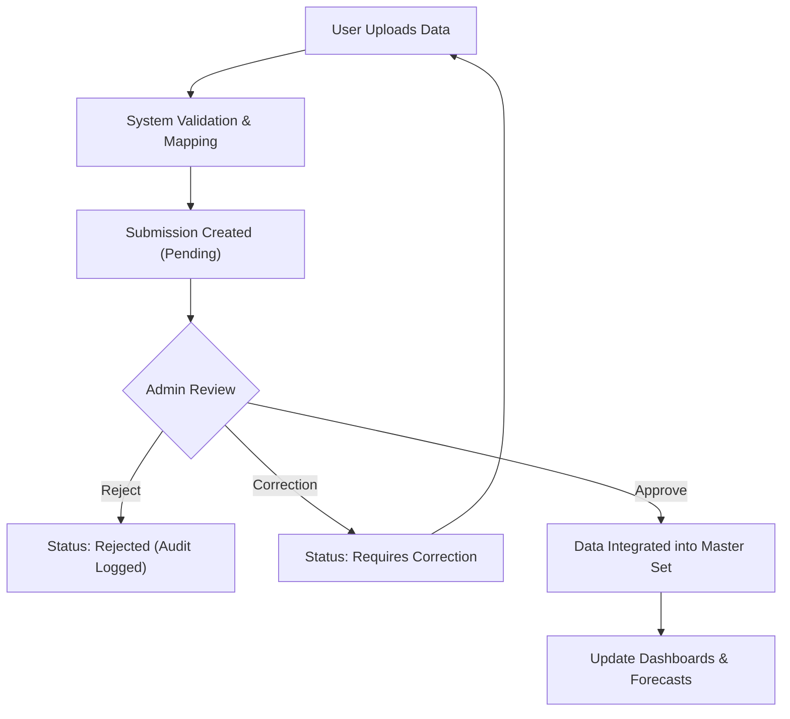

## 1. Product Overview
DengueCare AI is a professional urban dengue surveillance, forecasting, and early warning system designed for government health authorities. It enables efficient data collection from healthcare providers and provides advanced analytics to predict outbreaks and plan hospital resources.

The product aims to modernize public health response through role-based portals for data submission and administrative analysis, ensuring data integrity through a formal review workflow.

## 2. Core Features

### 2.1 User Roles
| Role | Registration Method | Core Permissions |
|------|---------------------|------------------|
| Submitter (Hospital/Clinic) | Demo Selection / Invite | Upload data files, track submission status, view history |
| Government Administrator | Demo Selection / Secure Login | Review submissions, approve/reject data, access analytics dashboard, view forecasts, hotspot analysis |

### 2.2 Feature Module
1. **Entry Page**: Portal selection (User vs Admin), system overview.
2. **User Portal**:
    - **Submission Form**: Organization metadata entry.
    - **File Upload**: Excel/CSV upload with validation preview.
    - **Submission History**: Status tracking and correction management.
3. **Admin Portal**:
    - **Overview Dashboard**: Key metrics and trend visualizations.
    - **Submission Management**: Approval workflow with detailed data inspection.
    - **Dengue Forecast**: Time-series prediction of future cases.
    - **Hotspot Analysis**: Geographic detection of high-risk areas.
    - **Weather Analysis**: Correlation analysis between climate and dengue.
    - **Hospital Preparedness**: Resource planning based on case forecasts.
    - **Audit Log**: Secure record of all system actions.

### 2.3 Page Details
| Page Name | Module Name | Feature description |
|-----------|-------------|---------------------|
| Entry Page | Selection Cards | Distinct entry points for User and Admin portals with demo labels. |
| User Portal | Upload Wizard | Step-by-step metadata entry, file upload, mapping, and validation. |
| User Portal | History Table | Filterable list of submissions with status and admin feedback. |
| Admin Dashboard | Metrics Overview | Summary cards for total cases, pending reviews, and active hotspots. |
| Admin Dashboard | Trend Charts | Weekly reported cases vs. Forecasted trends. |
| Admin Review | Data Inspector | Detailed preview of uploaded records with quality flags. |
| Forecast Page | Prediction View | Interactive charts showing historical data and future predictions. |
| Audit Log | Activity Stream | Chronological list of all user and system actions. |

## 3. Core Process
1. **Data Ingest**: Submitter uploads a CSV/Excel file and provides metadata.
2. **Validation**: System checks for format, duplicates, and invalid values. Submitter confirms mapping.
3. **Review**: Submission enters "Pending Review" status. Admin reviews data quality and integrity.
4. **Approval**: Admin approves, rejects, or requests correction.
5. **Integration**: Approved data is merged into the master analytical dataset.
6. **Analysis**: Dashboards, forecasts, and hotspot maps update automatically using only approved data.

## 4. User Interface Design
### 4.1 Design Style
- **Colors**: Navy Typography (#1e293b), Teal Primary (#0d9488), Light Grey Background (#f8fafc), Orange Warning (#f59e0b).
- **Buttons**: Rounded (rounded-md), subtle transitions, clear hierarchy.
- **Typography**: Clean sans-serif (Inter/Geist), readable font sizes (14px base).
- **Layout**: Sidebar-based navigation for Admin, focused center-aligned layout for User Portal.
- **Charts**: Clean, professional Recharts visualizations with tooltips.

### 4.2 Page Design Overview
| Page Name | Module Name | UI Elements |
|-----------|-------------|-------------|
| Entry Page | Hero Section | Centered logo, clear portal choice cards with hover effects. |
| Admin Portal | Sidebar | Fixed dark navy sidebar with icon-based navigation. |
| Admin Dashboard | Stats Cards | Minimalist cards with large numbers and trend indicators. |
| Review Page | Data Grid | Clean table with status badges and action buttons. |

### 4.3 Responsiveness
- Desktop-first for Admin Portal (data-heavy).
- Mobile-responsive for User Portal (easy submission on any device).
- Accessible color contrast and focus states.
