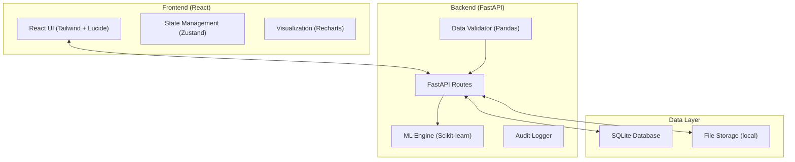
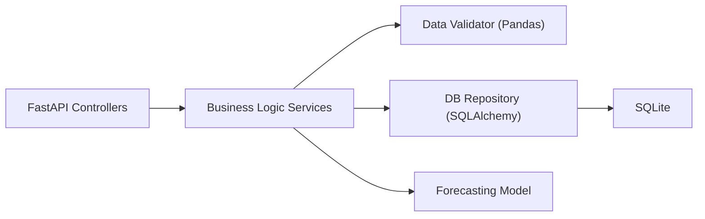
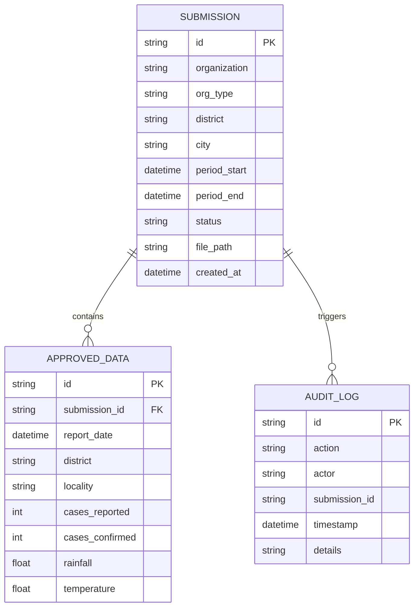

## 1. Architecture Design



## 2. Technology Description
- **Frontend**: React 18 + TypeScript + Vite + Tailwind CSS 3
- **Icons**: Lucide React
- **Charts**: Recharts
- **State Management**: Zustand
- **Backend**: Python 3.9+ + FastAPI
- **Data Processing**: Pandas + OpenPyXL
- **Machine Learning**: Scikit-learn (Linear Regression/Random Forest for forecasting)
- **Database**: SQLite (for academic prototype)
- **File Handling**: Local storage for uploaded .xlsx/.csv files

## 3. Route Definitions
| Route | Purpose |
|-------|---------|
| `/` | Landing page / Portal selection |
| `/user` | User Portal Dashboard |
| `/user/submit` | Data upload and submission form |
| `/user/history` | Submission history tracking |
| `/admin` | Admin Dashboard Overview |
| `/admin/submissions` | Submission management and review |
| `/admin/forecast` | Dengue case forecasting |
| `/admin/hotspots` | Geographic hotspot analysis |
| `/admin/weather` | Climate-dengue correlation |
| `/admin/preparedness` | Hospital resource planning |
| `/admin/audit` | System audit logs |

## 4. API Definitions

### Submissions
- `POST /api/submissions`: Submit new data file and metadata.
- `GET /api/submissions/my`: Get current user's submission history.
- `GET /api/admin/submissions`: List all submissions (Admin only).
- `POST /api/admin/submissions/{id}/approve`: Approve a submission.
- `POST /api/admin/submissions/{id}/reject`: Reject with reason.

### Analytics
- `GET /api/admin/dashboard`: Summary metrics for the dashboard.
- `GET /api/admin/forecast`: Get case forecasts.
- `GET /api/admin/hotspots`: Get hotspot analysis results.
- `GET /api/admin/audit-log`: Retrieve system logs.

## 5. Server Architecture Diagram



## 6. Data Model

### 6.1 Data Model Definition


### 6.2 Data Definition Language
```sql
CREATE TABLE submissions (
    id TEXT PRIMARY KEY,
    organization TEXT NOT NULL,
    org_type TEXT,
    district TEXT NOT NULL,
    city TEXT,
    period_start DATE,
    period_end DATE,
    status TEXT DEFAULT 'pending',
    admin_remarks TEXT,
    file_path TEXT,
    created_at DATETIME DEFAULT CURRENT_TIMESTAMP
);

CREATE TABLE approved_data (
    id INTEGER PRIMARY KEY AUTOINCREMENT,
    submission_id TEXT,
    report_date DATE,
    district TEXT,
    locality TEXT,
    reported_cases INTEGER,
    confirmed_cases INTEGER,
    hospital_visits INTEGER,
    rainfall REAL,
    temperature REAL,
    humidity REAL,
    FOREIGN KEY (submission_id) REFERENCES submissions(id)
);

CREATE TABLE audit_logs (
    id INTEGER PRIMARY KEY AUTOINCREMENT,
    action TEXT,
    actor TEXT,
    submission_id TEXT,
    details TEXT,
    timestamp DATETIME DEFAULT CURRENT_TIMESTAMP
);
```
